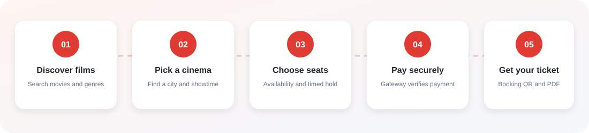
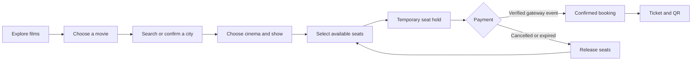
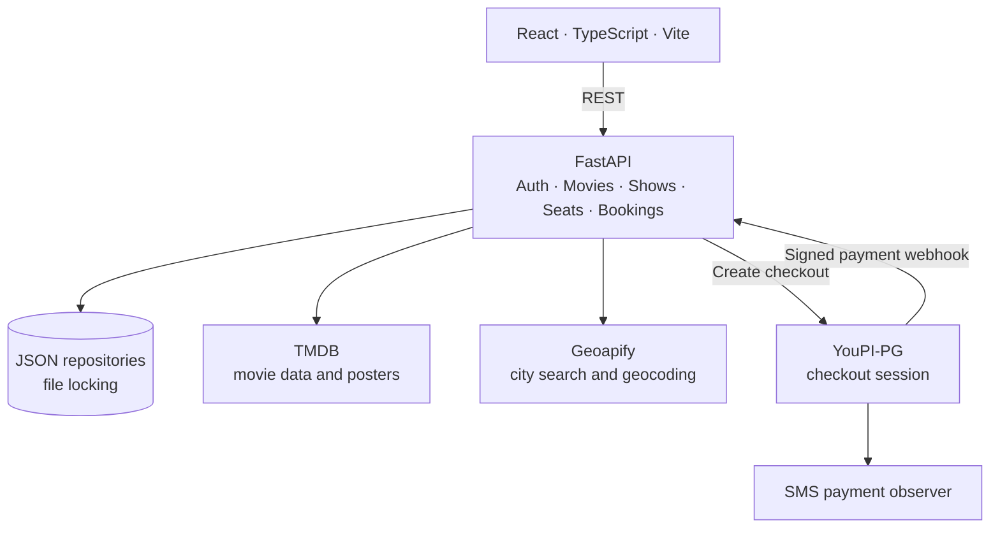
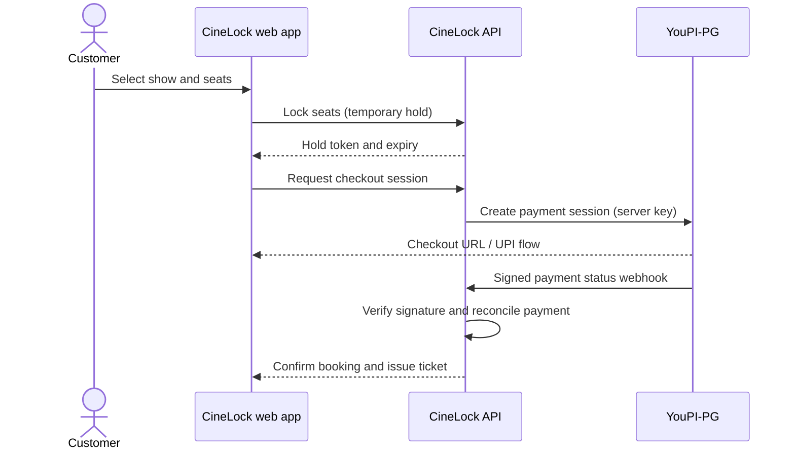

<div align="center">

# CineLock

### Find a film. Pick a cinema. Lock your seats. Enjoy the show.

**A full-stack cinema booking project with city-based theatre discovery, live seat locking, and reconciled UPI checkout.**

[](https://react.dev/) [](https://www.typescriptlang.org/) [](https://fastapi.tiangolo.com/) [](https://www.python.org/) [](https://vite.dev/)

</div>

## At a glance



| Discover | Choose | Book | Verify |
|:--|:--|:--|:--|
| Browse films, posters, and genres | Search a city and browse its demo cinemas | Select a show, screen, and available seats | Verify payment before issuing a ticket |

CineLock is a React and TypeScript web app backed by FastAPI. It covers the customer journey from movie discovery through ticket download, including expiring seat holds and payment reconciliation with the separately run [YouPI-PG gateway](https://github.com/youpi-pg/YouPI-PG).

> **Demo data:** Theatre and showtime availability is seeded sample data, not a live cinema-chain feed. Real UPI checkout requires a configured YouPI-PG instance and healthy payment observers. Never use production credentials in a public repository.

## Booking journey



### Seat states

| Available 🟢 | Selected 🔵 | Temporarily held 🟠 | Booked 🔴 |
|:--:|:--:|:--:|:--:|
| Ready to choose | In your selection | Checkout hold with expiry | Not selectable |

## Architecture





## Features

- Movie discovery, genre filtering, movie details, and poster artwork.
- Location search by city or neighborhood, plus browser location when permission is granted.
- Demo theatre/showtime data for supported locations; the customer explicitly chooses the theatre.
- Interactive seat maps, price summaries, expiring holds, and automatic release after timeout.
- Account registration and login, booking history, QR tickets, and PDF ticket download.
- YouPI checkout sessions created server-side; booking confirmation follows trusted payment reconciliation.
- Light, dark, and system theme options.

## Stack

| Area | Technologies |
|:--|:--|
| Frontend | React 18, TypeScript, Vite, Tailwind CSS, React Router, TanStack Query |
| Backend | Python, FastAPI, Pydantic, Uvicorn |
| Data | JSON file repositories with file locks (demo setup) |
| Integrations | TMDB, Geoapify, YouPI-PG |
| Tickets | QR generation and PDF export |

## Run locally

Requirements: Python 3.10+, Node.js 18+, npm. API credentials are optional for features that use external services.

### Backend (PowerShell)

```powershell
cd backend
python -m venv .venv
.\.venv\Scripts\Activate.ps1
pip install -r requirements.txt
Copy-Item .env.example .env
```

Set a private `JWT_SECRET_KEY` in `backend/.env`; add TMDB, Geoapify, and YouPI values as needed. Start the API:

```powershell
python run.py
```

API: [http://localhost:8000](http://localhost:8000) · Swagger docs: [http://localhost:8000/docs](http://localhost:8000/docs)

### Frontend (second terminal)

```powershell
cd frontend
npm install
Copy-Item .env.example .env.local
npm run dev
```

Open [http://localhost:5173](http://localhost:5173). Vite proxies API requests to FastAPI.

Movie and demo cinema/showtime data scripts live in `backend/scripts/`. Fetching live movie catalogue data requires a TMDB API key.

## External services

### TMDB and Geoapify

Set `TMDB_API_KEY` and `GEOAPIFY_API_KEY` in `backend/.env` to enable movie refresh/posters and city geocoding. Browser location requires user permission. Seeded theatre availability is demo data.

### YouPI-PG checkout

Run YouPI-PG separately using its [setup guide](https://github.com/youpi-pg/YouPI-PG). Keep the merchant API key and webhook secret in `backend/.env`; the frontend `.env.local` should contain only the checkout script URL and publishable key. Set YouPI's webhook destination to:

```text
http://localhost:8000/api/v1/payments/youpi/webhook
```

Allow the frontend origin `http://localhost:5173` in the gateway. New UPI checkouts require healthy YouPI payment observers. Never commit local `.env` files, credentials, or payment data.

## Repository map

```text
backend/app/api/          FastAPI route handlers
backend/app/models/       Domain models
backend/app/repositories/ JSON-backed persistence
backend/app/schemas/      Request and response models
backend/app/services/     Booking, seat, and payment logic
backend/app/tasks/        Background jobs
backend/scripts/          Demo data and movie scripts
frontend/src/components/  Shared and feature UI
frontend/src/hooks/       Query, auth, and booking hooks
frontend/src/pages/       Discovery, booking, payment, and account pages
frontend/src/services/    API clients
```

## API map

| Area | Example routes |
|:--|:--|
| Authentication | `/api/auth/register`, `/api/auth/login`, `/api/auth/me` |
| Movies and cinemas | `/api/movies`, `/api/theaters`, `/api/theaters/cities` |
| Shows | `/api/shows`, `/api/shows/by-movie/{movie_id}` |
| Seats | `/api/seats/map/{show_id}`, `/api/seats/lock`, `/api/seats/confirm` |
| Payments | `/api/payments/youpi/checkout-session`, `/api/payments/youpi/webhook` |
| Bookings | `/api/bookings`, `/api/bookings/{booking_id}/ticket` |
| Locations | `/api/locations/search`, `/api/locations/nearby-theaters` |

## Important limitations

- Cinema, screen, seat, and showtime inventory is mock/demo data unless connected to an inventory provider.
- JSON storage is for this project/demo; production needs transactional storage and secured HTTPS deployments.
- Redirects alone do not confirm payment. The server verifies payment reconciliation before issuing a ticket.
- No license file is included. Add a license before granting others reuse rights.
